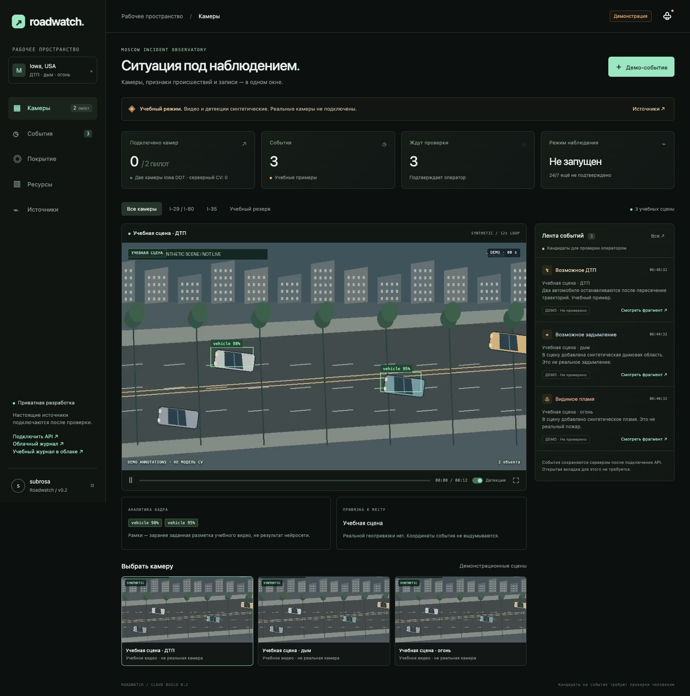

# Roadwatch

Закрытый исследовательский проект наблюдения за дорожными инцидентами и признаками пожара на открытых дорожных камерах Iowa DOT, США.

Рабочий план: начать с одной пригодной камеры, затем до трёх дополняющих друг друга дорожных ракурсов. Пользователь разрешил уменьшить охват и балансировать его по качеству и ресурсам. Приоритет — свежесть, полезный обзор и полный путь события до записи; прежние 50–100 камер не являются минимальным условием пилота.

**Статус v0.2:** приватный облачный API, D1 и хранилище клипов опубликованы через Sites. Реальных камер в автоматическом CV — **0 / 3**. Три опубликованных владельцем плеера добавлены отдельно от server CV; их наличие не считается подключённым мониторингом. Учебный облачный журнал содержит три явно синтетических события с сохранёнными MP4; это не результат нейросети на московских камерах.

- [Открыть облачную консоль](https://roadwatch-moscow-console.dealreal259.chatgpt.site)
- [Учебные события, сохранённые в облаке](https://roadwatch-moscow-console.dealreal259.chatgpt.site/?cloud-demo=1)
- [Текущая облачная архитектура, проверка и ограничения](docs/CLOUD.md)

**Ограничение бюджета:** банковскую карту пользователь не привязывает, включая верификацию free tier. [Актуальный план без карты](docs/NO_CARD_PLAN.md) имеет приоритет над предварительным списком провайдеров.



## Что уже можно проверить

- Вкладки I-29 / I-80, I-35 и учебный резерв, выбор камеры, воспроизведение учебного видео и рамки объектов.
- Ленту и журнал событий, открытие сохранённого MP4, скачивание, подтверждение и отклонение оператором.
- Реестр источников с честным статусом и калькулятор CPU/трафика/буфера для 50–100 камер.
- Подключение интерфейса к API с отдельным viewer token.
- На backend: сохранение наблюдений, подтверждение кандидата на двух кадрах, дедупликацию, квоты и запись events в SQLite.
- Приём и приватную выдачу видеофрагментов по авторизации с SHA-256 и Range playback.

## Первый запуск разработки

Node.js 24+:

```sh
npm ci --ignore-scripts
npm run init-env
npm run demo
```

Открыть `http://127.0.0.1:8787`. По умолчанию frontend показывает явную демонстрацию. Чтобы проверить сохранённый сервером журнал, нажать «Подключить API», задать адрес и VIEWER_TOKEN из приватного `.env`. Секрет не выводится в логи и не хранится в localStorage.

Demo backend создаёт синтетические события и прикрепляет настоящие MP4-файлы в отдельном каталоге `DATA_DIR/demo`. Для обычного backend — `npm start`; источники по умолчанию выключены. Пользовательский компьютер не предлагается как production-сервер: [облачное развёртывание описано отдельно](docs/DEPLOYMENT.md).

## Пайплайн

```text
Разрешённый HTTPS поток → FFmpeg ring + JPEG → YOLOv8 ONNX detector
  → API observations → candidate event → pre/post MP4 → журнал → review
```

Collector запускается независимо от браузера и сохраняет события при закрытой вкладке. Это работает только после его настоящего облачного запуска, настройки моделей и одобренных источников. Эти ресурсы пока отсутствуют; Dockerfile и конфигурация подготовлены.

В API-режиме frontend показывает последние JPEG с рамками, обновляя их при polling. Низколатентный live HLS/WebRTC gateway и push-уведомления при закрытом браузере ещё не реализованы.

В опубликованной версии добавлен отдельный Worker backend и серверное хранение. Чужие public embed воспроизводятся плеером владельца; их кадры не используются для автоматической разметки. Вкладка с плеером не является collector. Node backend и Worker backend — два варианта развёртывания с общими правилами валидации, но разными хранилищами и авторизацией.

## Почему 24/7 за $0 пока не обещается

При 100 камерах, 1 fps и предположении 50 мс CPU на inference требуется 3600 CPU-часов/месяц только для модели. 100 потоков по 1 Мбит/с дают 1.08 ТБ входящего видео/сутки. Буфер 60 секунд занимает около .75 ГБ, но его нужно непрерывно наполнять.

Это расчёт, не benchmark. Включённые 4 CPU-часа Vercel Hobby не подтверждают такой режим. Отдельного облачного аккаунта/VM у пользователя пока нет. Проект не создаёт платные ресурсы и не пытается обходить ограничения free-tier. [Полное сравнение](docs/CAPACITY.md).

## Проверки

```sh
npm test
npm run check
npm run capacity
# Browser QA, если установлен Chromium для Playwright:
npm run browserqa
# Collector mechanics (синтетические fixtures, не оценка accuracy):
uv run --python 3.12 --with-requirements collector/requirements.txt \
  --with imageio-ffmpeg python tools/test_collector.py
```

Реальные веса не загружаются автоматически. Для запуска collector нужны model manifest, SHA-256 и проверка качества; наличие адаптера inference не означает готовую модель ДТП.

## Документация

- [Исследование способов запуска: 41 сервис/тариф/программа, схемы и выбор](docs/RESEARCH_OPTIONS.md)
- [Облако v0.2 и фактически выполненные проверки](docs/CLOUD.md)
- [Архитектура и гарантии](docs/ARCHITECTURE.md)
- [Ресурсы и бесплатные тарифы](docs/CAPACITY.md)
- [Источники камер](docs/SOURCES.md)
- [API и события](docs/API.md)
- [Развёртывание](docs/DEPLOYMENT.md)
- [Модели и проверка качества](docs/MODELS.md)
- [Состояние разработки](docs/STATUS.md)

Распознавание личности и номеров не входит в проект. Событие модели — кандидат для проверки человеком; проект не заменяет экстренные службы.

Переход на США: [проверка камер](docs/INTERNATIONAL_CAMERAS.md), [точный ресурсный план](docs/IOWA_RESOURCE_PLAN.md).
