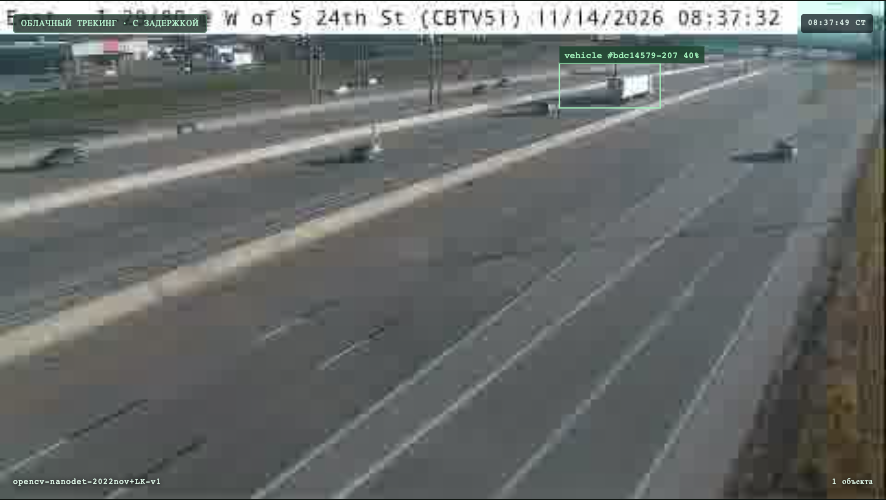
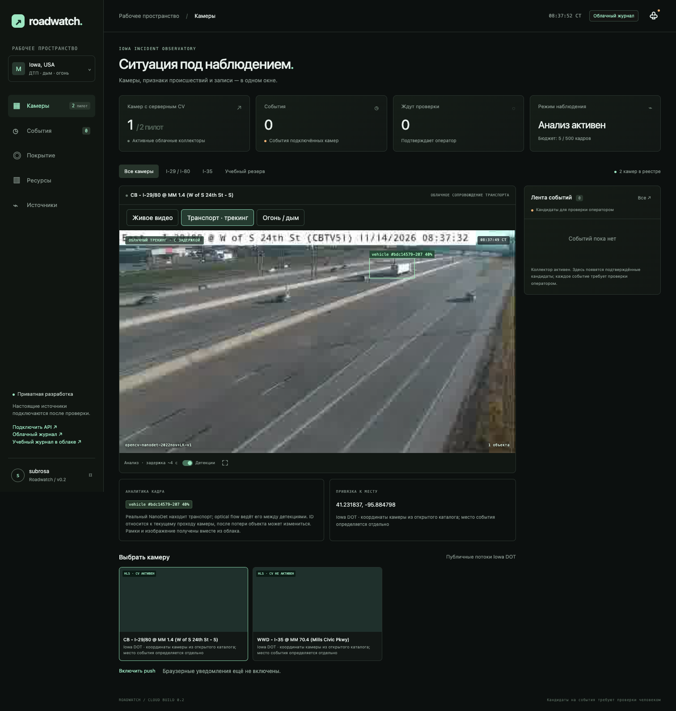

# Roadwatch

Roadwatch — платформа компьютерного зрения для наблюдения за дорожной обстановкой через открытые камеры. Она объединяет видео, сопровождение транспорта, поиск признаков огня и дыма, журнал событий и записи происшествий в одном веб-интерфейсе.

Обработка выполняется на отдельном облачном сервере. Камеры продолжают анализироваться при закрытом браузере; фронт показывает результаты, рамки объектов и сохранённые события.

[Открыть консоль](https://roadwatch-moscow-console.dealreal259.chatgpt.site) · [Развёртывание](docs/OWNER_FINAL_STEPS.md) · [Архитектура](docs/ARCHITECTURE.md)

Развёрнутая консоль имеет ограниченный доступ. Исходный код проекта доступен в этом репозитории; документация описывает настройку собственного экземпляра.

## Возможности

- **Просмотр камер.** Прямые HLS-трансляции, выбор источника и переключение между видео и результатами анализа.
- **Сопровождение транспорта.** Детектор находит автомобили и другие транспортные средства, трекер присваивает им временные ID и отслеживает перемещение. Рамки отображаются вместе с тем кадром, на котором они рассчитаны.
- **Огонь и дым.** Отдельная модель ищет визуальные признаки пожара. Повторные обнаружения формируют кандидата на событие для проверки оператором.
- **Журнал событий.** Камера, время, категория, результаты анализа и статус проверки собраны в одной карточке.
- **Видео происшествия.** Кольцевой буфер позволяет сохранять фрагмент до и после обнаружения; клипы доступны для просмотра и скачивания.
- **Уведомления.** Браузерные push-уведомления включаются по желанию пользователя.
- **Контроль ресурсов.** Ограничения CPU, хранения и публикации кадров помогают запускать небольшой набор камер на доступной облачной инфраструктуре.

## Интерфейс

Реальная камера Iowa DOT CBTV51, США. Скриншоты сняты с работающего интерфейса: рамки и ID получены облачным детектором и трекером.





## Как это работает

```text
Открытый HLS-поток
  → FFmpeg: декодирование и кольцевой буфер записи
  → NanoDet + optical flow: транспорт и временные ID
  → ONNX-модель: признаки огня и дыма
  → API: наблюдения, подтверждение кандидатов и видеоклипы
  → Веб-консоль: рамки, журнал, проверка и уведомления
```

Изображения и координаты объектов передаются согласованными парами. Для просмотра транспорта используется ограниченное окно кадров с воспроизведением по исходным временным меткам. Запись событий и фоновый анализ работают независимо от открытой вкладки.

## Технологии

| Компонент | Реализация |
| --- | --- |
| Веб-интерфейс | JavaScript, HTML/CSS, Canvas, HLS.js |
| Облачный коллектор | Python, FFmpeg, OpenCV |
| Сопровождение транспорта | NanoDet ONNX, Lucas–Kanade optical flow |
| Огонь и дым | YOLOv8 ONNX |
| Облачный API и хранение | Cloudflare Workers, D1, R2 через Sites |
| Альтернативный backend | Node.js и SQLite |
| Уведомления | Web Push с явным разрешением пользователя |

## Источники и ограничения

В конфигурации используются публичные дорожные камеры Iowa DOT. Обзор зависит от доступности потока, ракурса, освещения и разрешения исходного видео. Добавление других источников требует проверки их доступности и условий использования.

Модели могут пропускать объекты и давать ложные срабатывания. Оценка модели не является вероятностью происшествия; событие требует проверки человеком. Автоматическое распознавание ДТП пока не подключено. Лица и номера автомобилей не распознаются, ID транспорта относится только к кратковременному сопровождению в одной камере.

Профиль Hostrix подбирает 2–4 кадра/с по измеренной нагрузке, а HLS и сеть добавляют задержку. Квота передачи кадров просмотра отделена от фонового анализа. Бесплатный хостинг не даёт гарантии непрерывной работы 24/7. [Проверки качества и производительности](docs/TRACKING_TUNING.md) · [Ресурсный план](docs/IOWA_RESOURCE_PLAN.md).

## Запуск

Для облачного коллектора: [инструкция Hostrix](docs/OWNER_FINAL_STEPS.md) и [актуальный архив](https://roadwatch-moscow-console.dealreal259.chatgpt.site/downloads/roadwatch-hostrix-fix.zip). Архив в развёрнутой консоли доступен её владельцу; для собственного экземпляра его можно собрать командой `python3 tools/build-hostrix.py roadwatch-hostrix-fix.zip`.

Для локального знакомства с интерфейсом и явно обозначенными учебными данными нужен Node.js 24+:

```sh
npm ci --ignore-scripts
npm run init-env
npm run demo
```

Открыть `http://127.0.0.1:8787`. Учебные события отделены от реальных. Настройка рабочего backend, источников и моделей описана в [руководстве по развёртыванию](docs/DEPLOYMENT.md).

## Проверки

```sh
npm test
npm run check
npm run browserqa
```

Тесты охватывают API, авторизацию, согласованность кадров и рамок, трекинг, хранение событий, выдачу клипов и браузерный интерфейс. Сквозная проверка коллектора использует синтетические fixtures и не является оценкой точности моделей.

## Документация

- [Архитектура](docs/ARCHITECTURE.md)
- [API и события](docs/API.md)
- [Облачное развёртывание](docs/DEPLOYMENT.md)
- [Сопровождение транспорта](docs/VEHICLE_TRACKING.md)
- [Модели и проверка качества](docs/MODELS.md)
- [Источники камер](docs/INTERNATIONAL_CAMERAS.md)
- [Ресурсы и ограничения](docs/CAPACITY.md)
- [Уведомления и обработка событий](docs/RUNTIME_COMPLETION.md)
