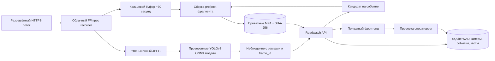

# Архитектура Roadwatch

## Продуктовый сценарий

Оператор открывает вкладку зоны, выбирает камеру, видит последний доступный кадр и привязанные к нему bounding boxes. Сервер продолжает принимать наблюдения, когда браузер закрыт. После появления признаков события оно попадает в журнал. Если recorder имеет нужный буфер, к событию добавляется фрагмент до и после его возникновения. Оператор просматривает доказательство и подтверждает/отклоняет кандидат.

Область: Москва и Московская область. Основной план: 30 камер внутри Садового кольца, 30 на ТТК/съездах, 40 на МКАД; минимальный масштаб 15/15/20. Это целевые количества, а не подключённые источники.

## Компоненты

### Фронтенд

`web/`: HTML/CSS/ES modules без runtime-фреймворка. Разделы: камеры, события, схема покрытия, ресурсы и источники. Видео демонстрации созданы кодом и промаркированы; bounding boxes — заранее заданные иллюстрации, а не вывод обученной модели. Реальный режим подключается через форму API, viewer token хранится только в памяти вкладки.

В реальном режиме клиент опрашивает API каждые 5 секунд. Это доставка последних снимков, не полноценный ретранслятор live-видео. Полноценный low-latency HLS/WebRTC gateway в v0.1 отсутствует. Рамки выводятся только когда `frame_id` картинки совпадает с `frame_id` наблюдения; старые рамки нельзя накладывать на новый кадр.

### Backend

`src/server.mjs` — Node.js 24+ HTTP API с отдельными ролями collector и viewer. `src/store.mjs` — SQLite WAL, наблюдения и события переживают закрытие браузера и перезапуск процесса при сохранном DATA_DIR. Принятая запись наблюдения, счётчик квоты и создание кандидата выполняются в одной транзакции `BEGIN IMMEDIATE`.

API на текущем этапе предназначен для VM/контейнера с постоянным диском. Его нельзя просто перенести в Vercel Function: локальный SQLite и каталог файлов там не являются постоянным распределённым хранилищем. Для serverless-варианта нужен отдельный D1/SQL adapter и object storage; в v0.1 это ещё не реализовано.

### Collector

`collector/collector.py`: предназначен для запуска в облаке. Источники включаются только явной конфигурацией и после отметки approval; автоматический поиск камер, подбор паролей и обход входа не реализуются. Поддерживаются HTTPS-потоки без встроенного логина/пароля. Секретные URL не должны попадать в коммиты или логи.

FFmpeg одновременно копирует поток в сегменты и извлекает уменьшенные JPEG с заданной частотой. Segment target — 2 секунды, wrap — 30 файлов; реальная длина зависит от keyframes/GOP. Поэтому «60 секунд» — ориентир, достаточность pre-roll требует проверки на конкретном источнике. Аудио исключается.

Детектор: CPU OpenCV DNN, YOLOv8 ONNX detection output без встроенного NMS, letterbox preprocessing, per-class NMS. Манифест задаёт SHA-256, список labels и размер входа. Модель не скачивается автоматически и не заменяется другой молча. Нет готовых проверенных весов для ДТП/пожаров и нет измеренного результата на московских камерах.

## Событийная логика

1. Проверить camera_id, schema, approved/enabled и происхождение demo/real.
2. Отклонить кадр старше 60 секунд и более чем на 5 секунд из будущего относительно API.
3. Идемпотентность по `(camera_id, frame_id)`; дубликат не тратит квоту повторно.
4. Не разрешать наблюдение старее последнего принятого кадра.
5. Для события нужны два различных последовательных кадра с одинаковым incident label, интервалом не более 6 секунд и достаточным score. Fire/collision threshold .8, smoke .85. Это стартовые параметры, не калиброванные бизнес-пороги.
6. Не повторять событие того же типа на той же камере в течение 120 секунд.
7. Создать `unreviewed` событие со статусом записи `unavailable`. Получение MP4 меняет его на `ready`.
8. Проверка оператором записывается отдельной audit-строкой. Модель никогда не ставит статус `confirmed` самостоятельно.

Два согласных кадра — временное подтверждение кандидата, а не доказательство аварии/пожара. Нет пространственного IoU-сопоставления инцидентов между кадрами, полноценного tracking-by-detection, различения нескольких происшествий одного типа на одной камере или объединения события между разными камерами. Эти ограничения важны для следующего этапа.

При выбранном окне 6 секунд редкие кадры раз в минуту/полчаса не образуют такой temporal-confirmation. Ресурсный калькулятор может показать их стоимость, но это ещё не поддерживаемый режим обнаружения события данным state machine.

## Видеосвидетельство

Collector после ответа API с новым событием сохраняет подходящие сегменты, дожидается post-roll и собирает MP4 H.264, до 25 МБ. Полнота pre-roll не гарантируется: recorder мог только стартовать, поток мог иметь разрывы или длинный GOP. Время привязывается к получению кадра collector, если источник не предоставляет подтверждённый timestamp. Clock provenance сохраняется.

У файла есть UUID, размер и SHA-256. Доступ к нему требует viewer token; поддерживается byte-range playback. API делает минимальную проверку MP4-контейнера, но не антивирусный или полный codec-аудит. Файлы не публикуются в репозитории. Default evidence budget — 500 МБ; при исчерпании API отвечает 507. Это защита диска приложения, а не гарантия нулевого cloud bill.

Текущие клипы не имеют криптографической подписи источника, доверенной метки времени и юридически доказанной цепочки хранения. SHA-256 позволяет обнаруживать изменение относительно сохранённой записи, но не доказывает подлинность исходного видео.

## Отказы и наблюдаемость

- Источник недоступен: нет новых наблюдений, health становится stale/no_data; отсутствие событий не означает безопасную обстановку.
- API недоступен/429/507/403: collector останавливается; закрываются FFmpeg-процессы. В v0.1 нет устойчивой offline-очереди и надёжной доставки клипов с retry.
- Перезапуск recorder: старые сегменты и JPEG не используются как новые.
- API process crash: SQLite транзакция защищает события/квоты; незарегистрированный файл после crash между rename и DB commit может остаться orphan. Нужна периодическая сверка.
- Storage retention применяется отдельной командой; полнота архива и защита от потери VM не гарантируются без резервного копирования.
- Browser closed: API/collector продолжают работу только если реально запущены в облаке. Статический frontend сам ничего не наблюдает в фоне.

## Дальнейшая архитектура

После одного подтверждённого реального источника: integration benchmark на 1/5/10 потоках, перенос хранения в выбранную облачную БД/объектное хранилище при необходимости, authenticated gateway для live HLS, spatial event linking, устойчивые задания записи, метрики покрытия/задержки и только затем увеличение до 50–100.
